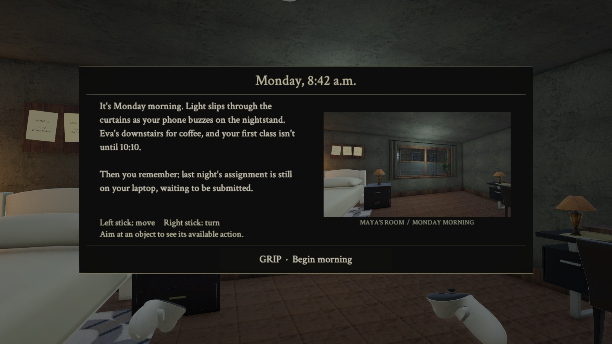
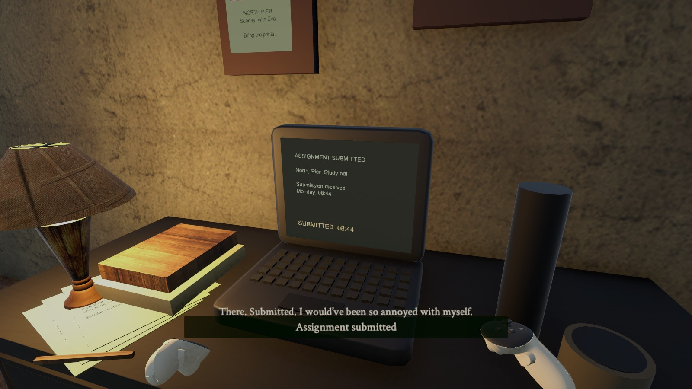

# The Feed
### A Quiet Morning

The Feed is a story-driven game about Maya, a college student who uses smart contact lenses to record and replay her memories. The idea is that something she relies on every day eventually makes her question what she remembers.

For this version, I focused on the beginning of her day. It's Monday morning, Eva is waiting downstairs for coffee, and Maya has just remembered an assignment she finished but never submitted. I wanted the interactions to feel like things she would actually do before leaving her room.

[Watch the walkthrough](Documentation/videos/Walkthrough.mp4) · [Quick interaction overview](Documentation/Interaction-Overview.pdf) · [Open the Unity scene](Assets/Scenes/TheFeed_Story_Guidance.unity)

## What happens in this version

1. **Start the morning.** The opening card introduces Maya's plans and lets the player begin.
2. **Text Eva back.** Maya asks Eva to grab a table and tells her she'll be down in five. The phone shows the reply being delivered.
3. **Submit the assignment.** The laptop uploads Maya's file and shows a confirmation. This replaces the earlier focus timer.
4. **Open the window.** Maya lets some fresh air in before leaving. The window moves, and the outdoor sound becomes louder.
5. **Head downstairs.** Once those things are done, the door opens and the ending card appears. The player can restart from there.

The phone, laptop, window and door use XR Simple Interactables. A subtle highlight and a short prompt show when an object can be used. Selecting it gives Maya's reaction, and activating it carries out the action. The story cards only appear the first time each object is encountered in a playthrough.

[See the five separate interaction clips](Documentation/Interactions.md)

## The look and feel

I wanted the room to feel like the start of an ordinary day, before the larger story starts to change. The Last of Us was a reference for the grounded mood and environmental storytelling. Elden Ring was a reference for the instruction cards: a little context, a clear action, and then back to the room.

## Try it in Unity

Use **Unity 6000.3.18f1**. Add the project folder in Unity Hub, let it finish importing, and open `Assets/Scenes/TheFeed_Story_Guidance.unity`. Press Play, then click inside the Game view.

- **WASD:** move.
- **Middle mouse + drag:** look around.
- **Mouse pointer:** aim at an object or button.
- **Left click / E:** select, read, or click a UI button.
- **Right click / Space:** activate an object's action.
- **Escape:** close a story card.
- **1-5:** jump to the saved demo views: opening, phone, laptop, window and door.

In the controller setup, Grip selects and Trigger activates. The left stick moves and the right stick turns.

## Where the project is right now

This is a working opening prototype. The phone reply, assignment submission, window, door, start/end cards and restart were checked in Unity using desktop XR controller simulation. The videos show that version.

I haven't tested this build on a physical headset yet, and there isn't a Quest APK included. The later memory-editing story is still planned. A grabbable phone, mirror/lens interaction, picking up belongings and a playable continuation outside the room are also still in progress.

## Tools and assets

The North Pier photo prop was AI-generated. The furniture and other existing assets are credited in [Asset Credits](Documentation/Asset-Credits.md).

The texting and assignment submission are fictional actions inside the game.
